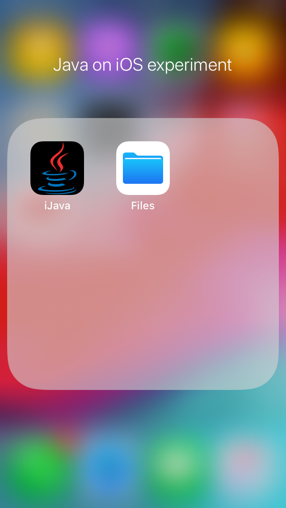

iJava is an experiment of running Java on older version of iOS (specifically iOS 12.5.8). instead of depending on **Runtime Translation Tools**, iJava's Unsigned IPA is directly produced by GitHub Actions of forked repository, WkWebViewApp. Application represents dark empty window which writes ``Experiment.txt`` file silently on background while printing text in XCode terminal. 

# What is the Runtime translation about? 
Apple only allows specific Development languages on IOS (such as Swift or Objective-C), any other language that isn't native to iOS is disallowed.
Regardless of whether its Java/JavaScript/Pascal/C/C++ none of them are able to run on iOS natively. to solve this, community around languages started Runtime Translation Tool projects to translate foreign code into code that is native to the platform. translated code is no longer in same language as it was before. 

# What does it mean in context of Java: 
Java indeed has Runtime Translation tools around it too, but workaround isn't simple for Windows users like me who have no access to MacOS at all, which is exactly what gives sophistication to this experiment, I managed to run Java on iOS without needing to use XCode directly. 
                      The original flow was: 
**Setup J2Objective-C on Windows -> let it translate .java file into .h and .m files -> create Command Line tool project in XCode and select Language as Objective-C -> attach those files -> set deployment target to iOS 12.5.8 -> produce .app file -> Run it. 
But the grass isn't always as greener as imagined, there are always nuances.**  
## **Runtime Translation Tools, Apps or services:** 
| Tool: | What it does: | Nuances: |
| :--- | :--- | :--- |
| J2Obj-C| Translates GUI-Less .java code into .h (header) and .m Objective-C code that needs to be attached to the XCode Command line tool project's structure.| Not for Windows, Eclipse plugin isn't maintained. |
| XCode | Only official IDE for iOS development. Lets you to create iOS projects, set deployment target, produce IPA file and more| Strictly for Mac, paid, Deployment target of 12.0 is removed. |
| RoboVM | Tool made for converting Java code into Objective-C code, includes Eclipse plugin.| Deployment from Eclipse only works on MacOS. |
| Codename One | close to RoboVM by converting Java code into Objective-C code, includes Eclipse plugin.| Not well-maintained. |
| Gluon Substrate + GraalVM | Gluon substrate is for JavaFX to iOS projects but technically allows Core Java to convert into Objective-C code with GraalVM.| Only works on MacOS to which I don't have access to. |
| SSH Console + Google Cloud | Many SSH console applications let you to run Java code across Google cloud.| Many SSH Console apps are crashing on iOS 12.0x |
| Stikdebug | Enables JIT (Just in Time) Compiler to run JAR file, especially for those who want to run Games such as Minecraft (like via PojavLauncher) | I don't want to run Games, I'm attempting specific experiment. |

## **Nuances:** 
| What was Expected: | What nuances showed up: |
| :--- | :--- |
| .app extension can run on iOS by clicking on it. | .app extension is for Apple store, it's not an signed IPA file which  you run by clicking on it.|
| J2Objective-C works on Windows | No, J2Objective-C is best supported on MacOS, and doesn't work easily on Windows.|
| XCode is something that I can get | XCode only is downloadable on Mac, but I only have windows.|
| J2Objective-C plugin on Eclipse is what I can try to use | J2Objective-C plugin on Eclipse had problems with installing as last maintaince of it was in Early 2012.|
| I can ask anybody to help me by using their XCode | Nobody minds helping without money.|
| I can use RoboVM on Eclipse | It doesn't work well on Eclipse.|
| The Codename one! I can use that! | Also doesn't work on Eclipse well.|
| Gluon Substrate + GraalVM on MacOS! | Asking someone to setup all those just to help me will be huge pain.|
| Run Java code by help of Cloud and SSH console on iPhone (Remotely) | Many SSH console apps don't support iOS 12.5.8 from Apple store or if some do, used to crash often.|
| Ask on Stack Overflow to get ideas about using J2Objective-C on Windows| J2Objective-C tag on SO isn't actively popular so answers there were specific and in small amount.|
| Trying to find Passionate iOS developer who understands XCode well on Reddit | Only trolls and user called 'CrocodiluQ' commented this experiment as "huge waste of time" (I like being specific so don't get amused).|
| I can ask on Discord iOS development discord servers to get help| Nobody wants to help even there.|
| Someone can try to set Deployment target to iOS 12.5.8| Apple removed Deployment target beyond iOS 13.0 in XCode and plus deployment is paid.|
| 3uTools would always be able to sign my IPA | 3uTools didn't always connect to Apple's services to sign IPA.|  

### What was overall solution: 
One day when I was wondering about what to do, I found one online Website that helped to translate my GUI-Less Java code into Objective-C code, I pasted code there and finally got ``code.m`` file. Finally I no longer needed to use any translation tools. then I told my friend about this who was using **XCodebuild** to make first IPA file and he did it with icon! but later it became harder and harder so he got me GitHub repository that I forked. But this repository relies on XCode project structure which I got by someone to who I'm very grateful
for. But during this experiment, I met with many different people. 

## **People's realitions behind iJava:** 
| Person: | Who is: | Did what: |
| :--- | :--- | :---|        
| ShadowX | Owner of iCodeWin and iCodeSwift. | Helped with Building first Unsigned IPA files, supported my experiment. |
| Bacho Dev (Bacho Oniani) | Georgian iOS developer. | Worked on overall XCode project structure and provided it. |
| One of the partners of Manager from topworknow.com | Used to have communication with manager of topworknow.com | First determined person to try XCode on their MacOS, their help was genuine but limited. |

## **Conclusion, how was the iJava built and what it represents:** 
When you download ``iJava.ipa`` file, it is Unsigned IPA and it needs to be signed by 3uTools or Sideloady to be installed on iOS 12.5.8 
When it is installed, it has an dark Java icon and when opening it up, there is an dark empty background. But in 3uTools inside of iJava's Sandboxed "Documents" folder, you can see ``Experiment.txt`` file. and in the XCode console, the printed text. iJava was built after Github actions that came along after Forking ``WkWebViewApp`` Github repository. this current repository contains XCode Project structure developed by Bacho Dev. 
**Sideloady:** https://sideloadly.io/index.html 
**3uTools:** https://www.3u.com/ 
**CodeConvert (website I used to translate Java code to Objective-C code):** https://www.codeconvert.ai/java-to-objective_c-converter 

 
